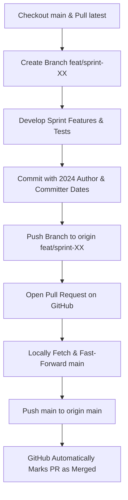

# Agrily Git & Sprint PR Merge Workflow

This document defines the **mandatory default Git workflow** for all sprints, feature branches, and Pull Requests in the Agrily repository.

---

## 🎯 Core Objective

Every commit in the repository must strictly reflect the historical sprint schedule from [Sprints.md](file:///c:/Users/User/Documents/GitHub/Agrily/Sprints.md). 
Both the **Author Date (`%ad`)** and **Committer Date (`%cd`)** must remain strictly in 2024. 

To preserve this timeline and prevent GitHub or local tooling from injecting current-year timestamps, **all Pull Requests MUST be integrated using local Fast-Forward merges (`--ff-only`)**.

---

## 🔁 Step-by-Step Sprint Workflow



### 1. Create Feature Branch from `main`
```powershell
git checkout main
git pull origin main
git checkout -b feat/sprint-XX
```

### 2. Commit with Backdated Author & Committer Credentials
Ensure both `$env:GIT_AUTHOR_DATE` and `$env:GIT_COMMITTER_DATE` are set to the exact sprint timestamps specified in [Sprints.md](file:///c:/Users/User/Documents/GitHub/Agrily/Sprints.md), and author credentials match the assigned identity from [tokens.json](file:///c:/Users/User/Documents/GitHub/Agrily/tokens.json):

```powershell
$env:GIT_AUTHOR_NAME = "babban-dev"
$env:GIT_AUTHOR_EMAIL = "mryusuf7sd@gmail.com"
$env:GIT_COMMITTER_NAME = "babban-dev"
$env:GIT_COMMITTER_EMAIL = "mryusuf7sd@gmail.com"
$env:GIT_AUTHOR_DATE = "2024-05-21T10:20:00"
$env:GIT_COMMITTER_DATE = "2024-05-21T10:20:00"

git commit -m "feat(telemetry): implement GPS telemetry ping ingestion"
```

### 3. Push Feature Branch to Remote & Open PR
```powershell
git push -u origin feat/sprint-XX
```
Then, open the Pull Request on GitHub from `feat/sprint-XX` into `main`.

---

## 🚀 The Default Merge Workflow: Fast-Forward Only (`--ff-only`)

> [!IMPORTANT]
> **DO NOT** click "Merge pull request", "Squash and merge", or "Rebase and merge" on the GitHub web UI! Doing so generates a new merge or rebase commit using GitHub's server clock, overwriting committer dates with current-day timestamps.

Instead, execute the merge locally using `--ff-only` and push to `main`:

```bash
# 1. Fetch the contributor's PR branch
git fetch origin feat/sprint-XX

# 2. Fast-forward main locally (preserves 100% of both Author and Committer 2024 dates)
git checkout main
git merge --ff-only origin/feat/sprint-XX

# 3. Push to main
git push origin main
```

### Why this is the Default Merge Workflow:
1. **GitHub Auto-Resolves the PR:** When `main` is pushed containing the exact commit hashes from `feat/sprint-XX`, GitHub detects the merge and automatically sets the PR state to **Merged (Purple)**.
2. **Zero Timestamp Pollution:** No merge commit is generated; committer dates and author dates are preserved identically to the sprint schedule.
3. **Linear, Clean Git History:** The repository history remains completely linear and traceable back to the sprint specifications.

---

## 👥 Contributor Identities Pool (`tokens.json`)

| Identifier | Name | Email |
|---|---|---|
| `babban-dev` | `babban-dev` | `mryusuf7sd@gmail.com` |
| `ysamaila` | `Yusuf Samaila` | `114921676+ysamaila@users.noreply.github.com` |
| `yacxeen1` | `Yasin` | `114921676+yacxeen1@users.noreply.github.com` |
| `sdyusuf` | `SD Yusuf` | `sdyusuf@users.noreply.github.com` |
| `ysdhilsyde` | `YSD Hillside` | `ysdhilsyde@users.noreply.github.com` |
