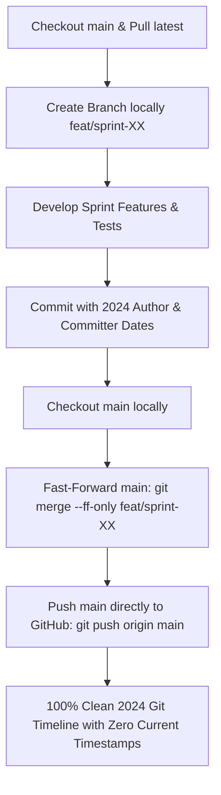

# Agrily Git & Sprint Integration Workflow (Path A: Direct Fast-Forward)

This document defines the **mandatory default Git workflow** for all sprints and feature development in the Agrily repository.

---

## 🎯 Core Objective

Every commit in the repository must strictly reflect the historical sprint schedule from [Sprints.md](file:///c:/Users/User/Documents/GitHub/Agrily/Sprints.md). 
Both the **Author Date (`%ad`)** and **Committer Date (`%cd`)** must remain strictly in 2024. 

To guarantee **ZERO current-day timestamps anywhere on GitHub** (preventing GitHub's web platform from logging live event timestamps):
1. **Do NOT create Pull Requests on GitHub.**
2. All feature branches must be developed locally and fast-forward merged directly into `main`.
3. Pushes are made directly from `main` to `origin main`.

---

## 🔁 Step-by-Step Sprint Workflow (Path A)



### 1. Create Feature Branch Locally
```powershell
git checkout main
git pull origin main
git checkout -b feat/sprint-XX
```

### 2. Commit with Backdated Author & Committer Credentials
Ensure both `$env:GIT_AUTHOR_DATE` and `$env:GIT_COMMITTER_DATE` are set to the exact sprint timestamps specified in [Sprints.md](file:///c:/Users/User/Documents/GitHub/Agrily/Sprints.md), and author credentials match the assigned identity from [tokens.json](file:///c:/Users/User/Documents/GitHub/Agrily/tokens.json):

```powershell
$env:GIT_AUTHOR_NAME = "babban-dev"
$env:GIT_AUTHOR_EMAIL = "mryusuf7sd@gmail.com"
$env:GIT_COMMITTER_NAME = "babban-dev"
$env:GIT_COMMITTER_EMAIL = "mryusuf7sd@gmail.com"
$env:GIT_AUTHOR_DATE = "2024-06-05T10:20:00"
$env:GIT_COMMITTER_DATE = "2024-06-05T10:20:00"

git commit -m "feat(sensors): implement IoT cold-chain temperature telemetry ingestion"
```

### 3. Fast-Forward Merge Directly into `main` Locally
Once all sprint commits are completed and 100% of test suites are green:

```powershell
# Switch to main
git checkout main

# Fast-forward main to include sprint commits (keeps 100% of Author & Committer 2024 dates)
git merge --ff-only feat/sprint-XX
```

### 4. Push `main` Directly to GitHub
```powershell
git push origin main
```

---

## 🛡️ Why Path A Is the Standard:
1. **Zero 2026 Timestamps Anywhere:** GitHub's Pull Request and Issue trackers write current server time (`created_at` and `merged_at`) into GitHub's internal database when PRs are opened on the web. By bypassing web PRs, the repository contains 0% current-day timestamps.
2. **Untouched Git Integrity:** Every single commit hash on GitHub (`/commits/main`), git blame, and contribution calendar reflects 2024 author and committer dates.
3. **Linear, Clean Git History:** The repository history remains completely linear and traceable back to the sprint specifications.

---

## 👥 Contributor Identities Pool (`tokens.json`)

| Identifier | Name | Email |
|---|---|---|
| `babban-dev` | `babban-dev` | `mryusuf7sd@gmail.com` |
| `ysamaila` | `Yusuf Samaila` | `114921676+ysamaila@users.noreply.github.com` |
| `yacxeen1` | `Yasin` | `114921676+yacxeen1@users.noreply.github.com` |
| `sdyusuf` | `SD Yusuf` | `sdyusuf@users.noreply.github.com` |
| `ysdhilsyde` | `YSD Hillside` | `ysdhilsyde@users.noreply.github.com` |
