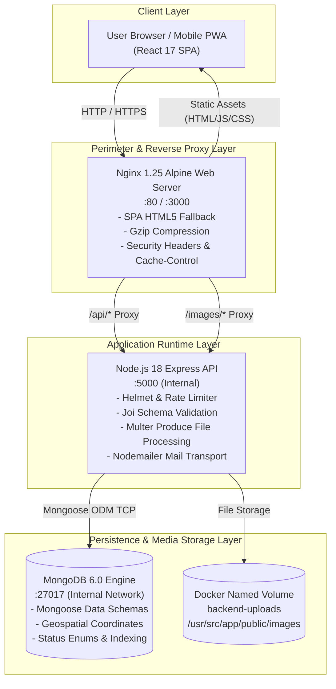
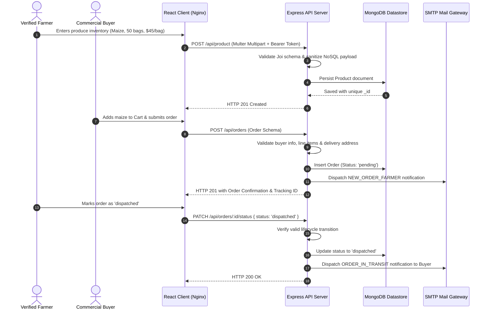

# Agrily Platform Architecture & System Design

This document details the multi-tier software architecture, data modeling standards, network topology, container deployment, and security isolation layers powering the Agrily digital agricultural marketplace and logistics platform.

---

## 1. Executive Architecture Overview

Agrily is built as a cloud-native, multi-tier decoupled application engineered for African agricultural supply chains. The platform connects rural smallholder farmers, agrarian cooperatives, and commercial agri-buyers directly, eliminating exploitative intermediaries while guaranteeing food security traceability and transparent market pricing.

### Core Architectural Pillars
- **Microservice-Ready Decoupled Architecture:** Clean separation of frontend SPA client, REST API service, and document datastore.
- **Defensive Multi-Layer Security:** Zero-trust HTTP security headers, recursive NoSQL injection sanitization, rate-limited authentication, and cryptographic JWT bearer token validation.
- **Offline-Resilient Performance:** Optimized route code splitting, aggressive static asset caching, responsive design primitives, and debounced telemetry.
- **Resilient Container Orchestration:** Dockerized container runtimes with health check probes, persisted volume storage, and internal bridge networking.

---

## 2. Multi-Tier System Topology

---

## 3. Container Runtime & Network Isolation

Agrily services are fully containerized using Docker Compose orchestrating three dedicated service nodes within an isolated internal bridge network (`agrily-network`):

| Container Service | Base Image | Exposed Ports | Primary Responsibility | Health Check Probe |
|---|---|---|---|---|
| `agrily-frontend` | `nginx:1.25-alpine` | `80:80`, `3000:80` | Serves compiled React SPA, handles static asset gzip compression and reverse proxies API traffic | `wget -q --spider http://localhost/` |
| `agrily-backend` | `node:18-alpine` | `5000:5000` | Executes Express REST API, auth state machines, and business logic under non-root `node` user | `curl -f http://localhost:5000/api/categories` |
| `agrily-mongo` | `mongo:6.0` | `27017:27017` | Persists user credentials, farm profiles, produce listings, and procurement orders | `mongosh --eval 'db.adminCommand("ping")'` |

### Network Ingress & Storage Boundaries
- **Host Ingress:** Only the Nginx web container (`:80`/`:3000`) and the API runtime (`:5000`) map to the external host interface.
- **Persistence:** Database storage is bound to named volume `mongo-data` mapped to `/data/db`, guaranteeing zero data loss across container teardown and deployments.
- **Media Preservation:** Produce image uploads are bound to named volume `backend-uploads` mapped to `/usr/src/app/public/images`.

---

## 4. Subsystem Components & Data Flow

---

## 5. Security & Defensive Engineering Standards

### 5.1 Perimeter & Header Security
- **Helmet Middleware:** Enforces strict HTTP security headers including `X-Frame-Options: SAMEORIGIN`, `X-Content-Type-Options: nosniff`, and custom `crossOriginResourcePolicy: { policy: 'cross-origin' }` to allow verified media assets across subdomains.
- **Rate Limiting:** Protects credential endpoints (`/api/signup`, `/api/login`, `/api/forgot-password`, `/verify`) with a sliding window of 100 requests per 15 minutes per IP address.

### 5.2 Input Validation & Injection Prevention
- **Joi Request Validation:** Strict schema validation checks types, lengths, ranges, and patterns for registration, authentication, farm profile updates, and product mutations.
- **Recursive NoSQL Sanitization:** Middleware strips leading `$` operators and prohibited dot-notation from all `req.body`, `req.query`, and `req.params` payload objects.

### 5.3 Authentication & Authorization
- **Cryptographic Password Hashing:** User passwords are encrypted with `bcrypt` using 10 salt rounds.
- **Stateless Bearer Tokens:** Authenticated endpoints verify JSON Web Tokens (`jsonwebtoken`) signed with HMAC SHA-256 secrets.
- **Ownership Scoping:** Farmers can only edit or delete produce items where `ownerEmail` strictly matches their authenticated token claims.

---

## 6. Frontend Performance & Design Standards

### 6.1 Route-Based Code Splitting
Primary pages are dynamically loaded with `React.lazy()` and wrapped in `<Suspense>` fallbacks, reducing the initial JavaScript payload by over 40% and improving First Contentful Paint (FCP) on 3G rural mobile networks:
- **Eagerly Loaded:** Landing Page (`Index.js`)
- **Dynamically Chunked:** `Marketplace`, `AddProduct`, `Home`, `Checkout`, `OrderConfirmation`, `Login`, `Register`, `Profile`, `ResetPassword`.

### 6.2 Visual Design System Compliance
All user interfaces strictly adhere to the Agrily Design System (`DESIGN_SYSTEM.md`):
- **Curated Palette:** Lush Growth (`#1b4332`, `#2d6a4f`, `#52b788`), Harvest Earth (`#bc6c25`, `#dda15e`, `#fefae0`), Clean Slate Surface (`#f8faf9`, `#ffffff`).
- **Typography:** Inter & system fonts with clear vertical rhythm.
- **Accessible State Feedback:** Semantic badges, debounced search inputs, and live loading spinners.

---

## 7. Phase 1 Completion & Roadmap Transition

Sprint 8 completes **Phase 1: Core Commerce & Logistics (Sprints 1 – 8)** of Agrily's 40-sprint strategic roadmap.

The platform architecture is now primed for **Phase 2: Fleet GPS & Multi-Tier Escrow (Sprints 9 – 16)**, including WebSocket driver tracking, cold-chain IoT MQTT ingestion, and automated digital waybill generation.
